# Poromodo Timer Development Journal

Below I have detailed the development of the various aspects of the battery powered Pomodoro timer. These entries have been listed in the order they were completed.

The main components of the project are the Seeed XIAO ESP32-C3, 0.96" 128x64 I2C OLED screen, GY-521 MPU-6050 module, BUZZER, buttons, status LED and 2S battery. The battery will be used to power the AP63205 buck regulator to produce a 5V rail.

Some images and code snippets have been included. Firmware sketches have been created as such; these should not be taken as any indication that they have been tested successfully on the hardware.

# 2026-11-08: schematic creation, initial power circuit

**Total time spent: 4 hours**

The creation of the schematic began with adding the header for the OLED display. There were symbols for the display in the library but I wasn’t too sure that they were the exact ones I would be using for the ready made module. I decided to go with a basic 4 pin header to keep it separate from the exact symbol for the module.

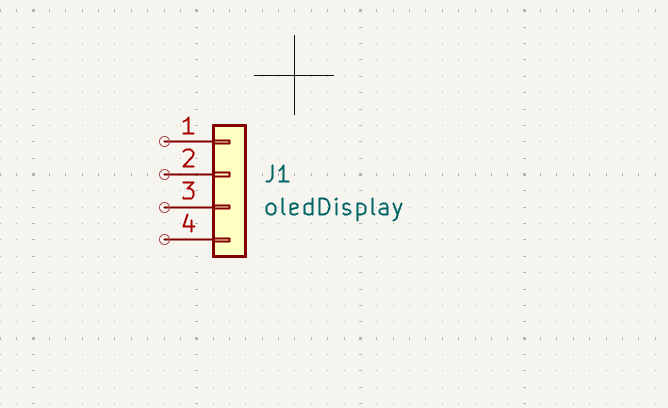

Next was adding in the Seeed XIAO ESP32-C3 symbol. Whilst checking the pin names I noticed that the VBUS pin was for powering the device with 5V. The 3V3_OUT pin is from the regulator inside the module. The VBAT pin is for powering the module with a single cell battery so was left disconnected as this uses a 2S pack. D4 and D5 were going to be used for the I2C communication.

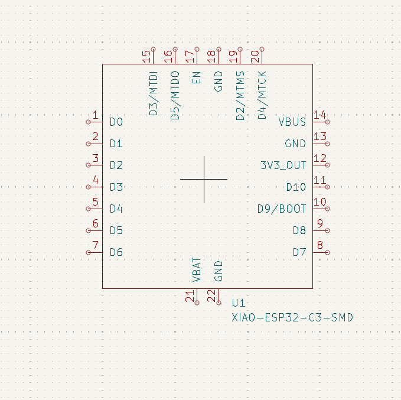

The 4 pins of the header were assigned to GND, +3V3, SCL and SDA. This was a temporary assignment. Not all OLED modules have their pins in the same order. I will need to cross reference the footprint and silk screen with the exact module I am using. The SDA and SCL nets required connection to the XIAO pins.

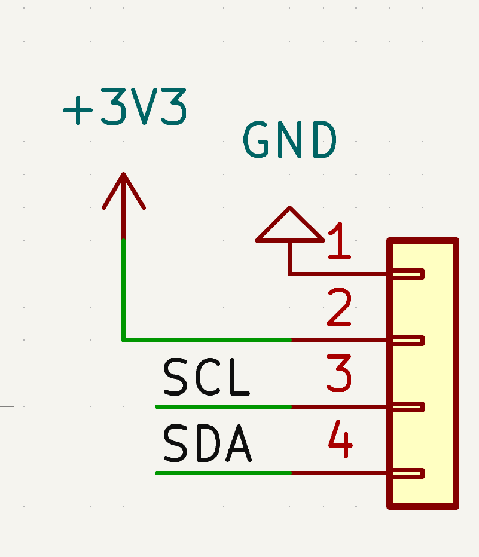

The board is going to be powered from a 2S Li battery. This has a nominal voltage of 7.4 volts and a fully charged voltage of 8.4 volts. I checked the documentation for the XIAO and decided to use a 5V buck regulator. The VBUS pin can be powered from the buck regulator with a Schottky diode. The XIAO will then generate its own 3.3V rail for powering the display and other logic.

However the XIAO does have a built in charger for single cell batteries. The battery will require an appropriate external charger or BMS. From looking at the documentation there were varying current values for the 3.3V rail so I went with the lowest value (500mA) for a safe design.

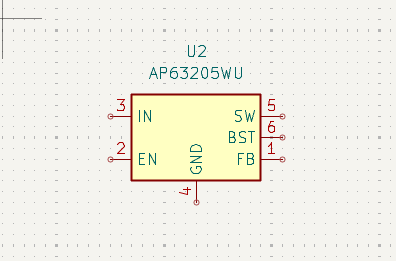

In my initial attempt I had made a few mistakes with basic wiring. The input capacitor was placed in series with the power supply and would prevent DC current. The bootstrap capacitor wasn’t connected between BST and SW. The output capacitors weren’t connected to GND properly. The feedback resistor divider wasn’t required as this is the fixed 5V version of the AP63205. The input and output nets had incorrect names.

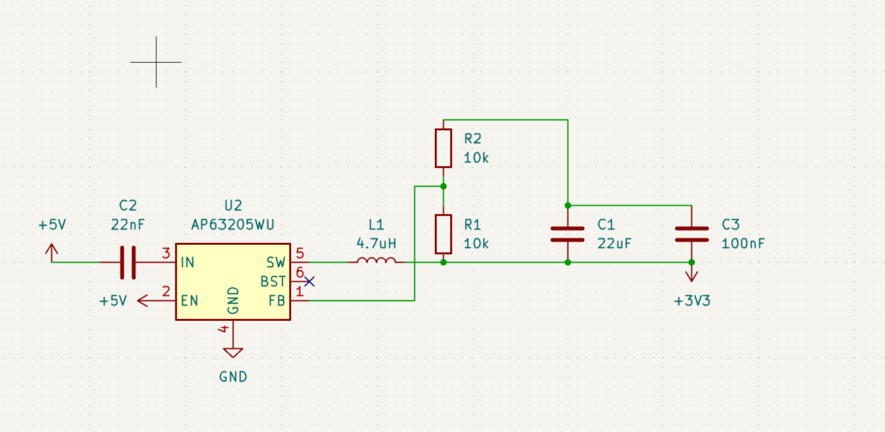

I re-drew the circuit based on the typical application shown in the datasheet. The input from the battery was given the net name VBAT_SW and the output from the regulator was given the net name +5V. In my second attempt I noticed two issues. Both 22uF capacitors were in series rather than parallel and the inductor value was incorrect (4.1uH instead of 4.7uH).

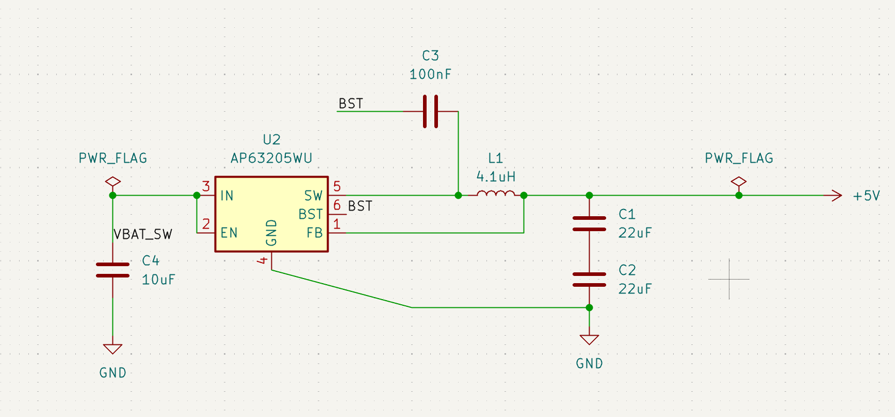

Connecting the capacitors properly, the input capacitor was connected between the input rail and GND. Both output capacitors were in parallel. The bootstrap capacitor was connected between BST and SW. The feedback pin had the correct connections for the fixed version. I added the PWR_FLAG symbols to the main power nets so they are recognised by KiCad’s electrical rule checker.

The power section now looks much more like the circuit from the datasheet. However I still need to complete the rest of the schematic. The battery connector, switch, reverse polarity protection, battery divider, buttons, BUZZER and LED will be added in future sessions.

I learnt that just because a circuit looks connected doesn’t mean it is! I need to check the capacitor connections, net names and the exact regulator type are from the datasheet. Not just a generic typical application.

# 2026-11-09: Battery input, Switch and Reverse Polarity Protection

**Total time spent: 3 hours**

Next was connecting the battery. As it is a 2S battery it will have a nominal voltage of 7.4 volts and a full charge voltage of 8.4 volts. I wanted to include a proper on/off switch for the battery and some reverse polarity protection. For my initial attempt I added a 2 pin battery connector. However in my initial schematic I incorrectly assigned the positive pin to +5V. This is because the battery isn’t a 5V power source. It would also connect the battery directly to the output of the buck regulator.

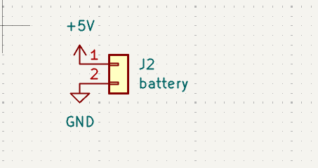

I added a switch in series with the battery. Initially I used the SW_Push symbol provided by KiCad. This is a momentary switch so the circuit would only be powered whilst the button was being pressed. I needed this to be a latching switch so I adapted my design to use the SW_SPST connection. This can be connected to an appropriate slide switch in the future.

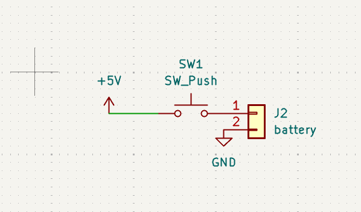

I decided to use a P-channel MOSFET for reverse polarity protection. Using a diode would cause some voltage drop from the battery. A MOSFET can be wired correctly to have a very low voltage drop when powered. Initially I selected the AO3400A however this is an N-channel MOSFET. I was going to use the AO3401A.

I also had a wiring issue. The source was connected to GND and the gate was connected to the battery. This caused the circuit to act like a low-side switch. Simply changing the component wouldn’t correct this issue as the wiring wasn’t correct. I checked the gate, source and drain connections on the MOSFET symbol.

The battery positive is connected through the latching switch to the MOSFET drain. The gate is connected to GND and the source to the VBAT_SW net. This provides power to the input of the buck regulator. The negative of the battery is connected to GND. The momentary switch has been replaced with the latching SW_SPST symbol.

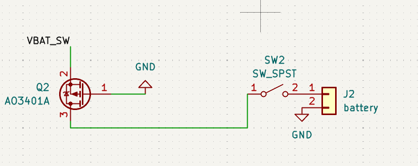

I still need to check the footprint of the MOSFET and ensure the pins are in the correct order from the datasheet for the AO3401A. I don’t want to assume the KiCad symbol pin numbers match the actual SOT-23 package.

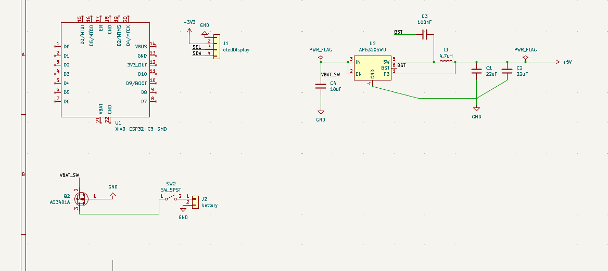

At this stage the battery connector, switch and reverse polarity protection have been connected to the VBAT_SW net and input of the buck regulator. The display and XIAO have been added to the schematic however the battery divider, Schottky Diode, buttons, BUZZER and status LED still need to be added or connected.

I learnt that the net names aren’t just labels. Any net with the power label will be connected together. I had mistakenly connected the +5V net to the battery connector which created an electrical error. I also learnt to check what type of MOSFET I was using and ensure the pins of the component are correct.

# 2026-11-09: Buzzer Driver and MPU-6050 Module

**Total time spent: 4 hours**

I wanted the BUZZER to sound when starting and finishing a focus or break session. I didn’t want to drive a magnetic BUZZER directly from the ESP32 GPIO so added a small NPN transistor to switch it. The positive of the BUZZER is connected to the power rail, the other side to the collector of the transistor. The emitter is connected to GND and the base powered from the BUZZER net with a 1k resistor.

I added a flyback diode across the BUZZER. This is due to the BUZZER having a coil, causing a voltage spikes when turning it off. This allows the current to flow. In my initial attempt the diode was incorrectly connected near the base of the transistor. I moved it to be across the BUZZER.

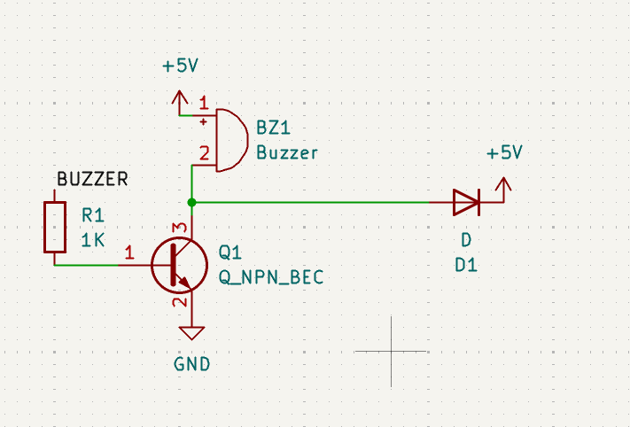

Next I wanted to add auto screen rotation. This can be done using the MPU-6050 as it can provide acceleration across the 3 axis. This allows us to get a rough idea of the direction of gravity and determine how the timer is being held. I added the MPU-6050 chip symbol to the schematic and began connecting the power and I2C pins.

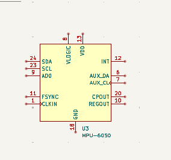

Whilst checking the pins I realised the chip requires more circuitry to support it. Some pins need to be connected to specific pins. Others require capacitors. The I2C lines require pull-ups. It also has a small QFN package which will be difficult to solder by hand. I decided to go with a ready made module instead.

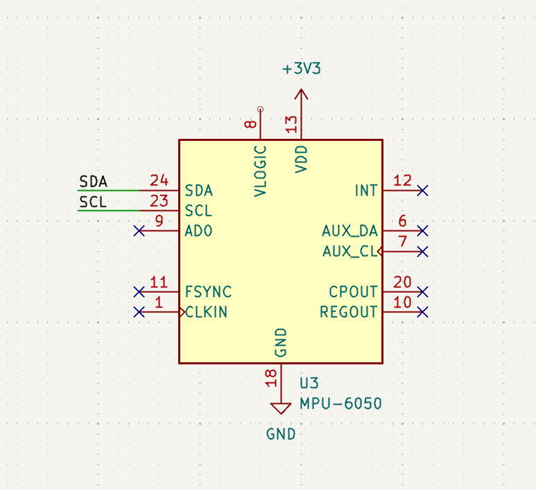

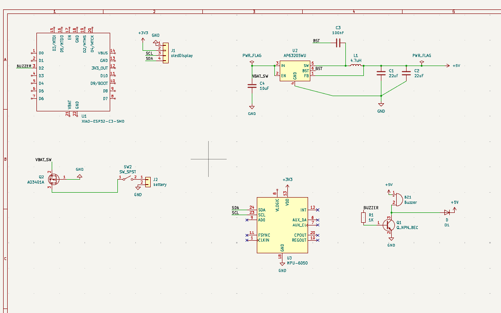

I updated the design to use the GY-521 module with an 8 pin socket. This module includes the extra circuitry and I2C pull-ups. I used the pin order from the module as a reference. The pins are: VCC, GND, SCL, SDA, XDA, XCL, AD0 and INT.

The VCC pin is connected to +3V3, the GND to GND, SCL and SDA to the shared I2C bus and INT to the MPU_INT net. The XDA and XCL pins aren’t used. The AD0 pin also isn’t used as it is pulled low by the module providing the expected I2C address of 0x68.

I noticed a small typo whilst connecting the module. I had used SDL instead of SDA. KiCad sees these as different nets and the sensor wouldn’t have shared the data line with the display.

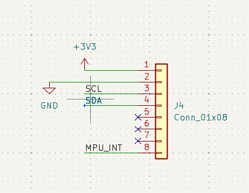

The XIAO, OLED header, buck regulator, battery connection and protection, BUZZER driver and GY-521 header have been added to the schematic. Most of the sensor and control signals need to be connected to the correct pins on the XIAO in the next schematic session.

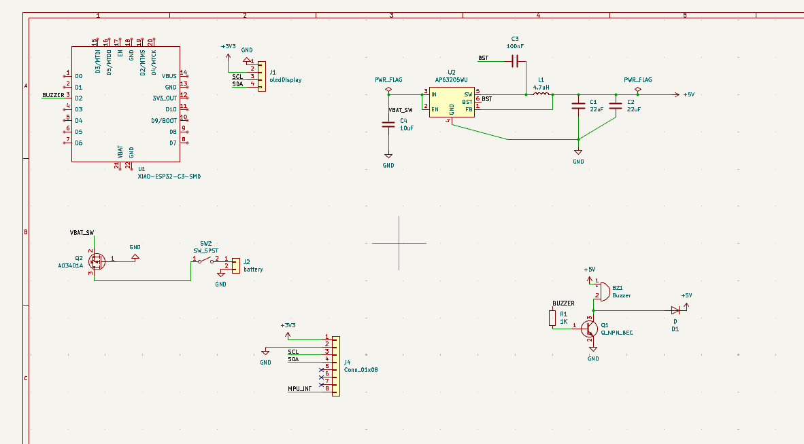

I learnt that using a module can help avoid a lot of extra circuitry. However I still need to check the pin order of the connector. I also learnt that a typo can cause two connections to not be connected together.

# 2026-11-09: Connect XIAO, Battery Monitor, Buttons and LED

**Total time spent: 3 hours**

With the major components added I began connecting them using the named nets. D1 was assigned to BAT_SENSE, D2 to BUZZER, D3 to MPU_INT, D4 and D5 to SDA and SCL, D6 and D7 to BTN1 and BTN2 and finally D10 to the status LED. The 3V3 output was assigned the +3V3 label. The GND pins were connected. VBUS was assigned to the 5V_SYS rail.

The VBAT pin wasn’t connected as the board uses a 2S battery. I also noted any pins that were intentionally left unconnected.

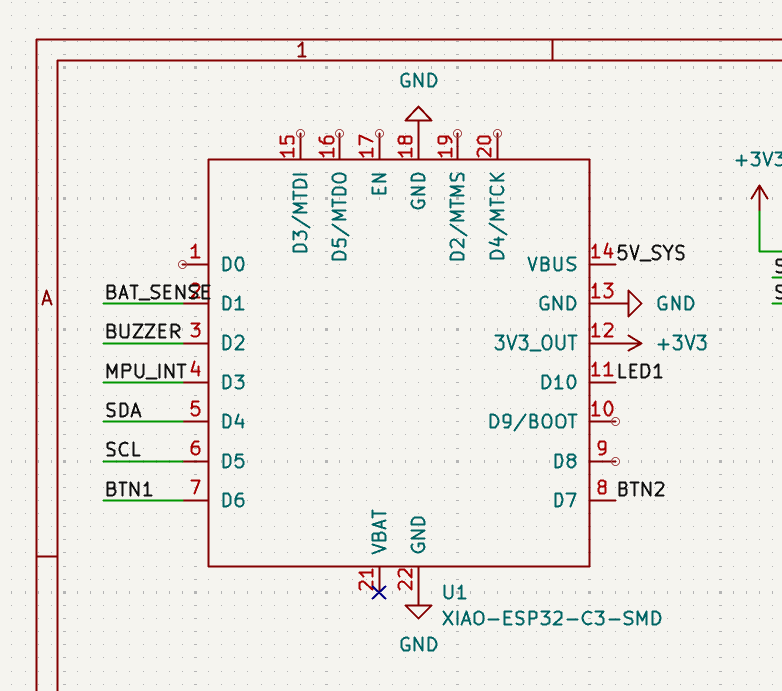

The ADC on the ESP32 can’t read the full 8.4V from the battery so a resistor divider was added. Initially I used a 100k and 47k resistor. However after calculating the voltage across a fully charged pack I changed the bottom resistor to 33k to give a larger margin.

The final resistor divider uses a 100k resistor from VBAT_SW to BAT_SENSE and a 33k resistor from BAT_SENSE to GND. A 100n capacitor was added from BAT_SENSE to GND to smooth the voltage. As this is after the power switch only current is drawn when the timer is switched on.

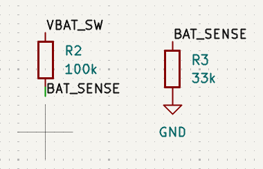

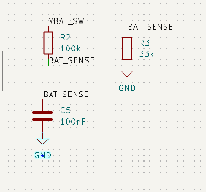

A Schottky Diode was added between the +5V output of the buck regulator and the 5V_SYS rail of the XIAO. The anode was connected to the output of the buck and the cathode to the XIAO. This allows the buck to power the XIAO and minimises the chance of the USB power feeding back into the output.

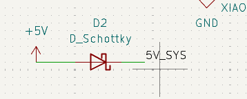

A status LED was added to D10 with a 470 ohm resistor. The cathode of the LED was connected to GND. Two push buttons were added. BTN1 was connected between BTN1 and GND. BTN2 was connected between BTN2 and GND. The firmware will use the internal pull-ups of the ESP32 so no external pull-up resistors were added.

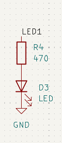

All of the main components have been added. I noticed that the BUZZER was connected to both +5V and 5V_SYS. I wanted the BUZZER to be powered from 5V_SYS so it can be powered when the board is using USB and the battery buck regulator isn’t on. I also need to add no-connect flags to the unused pins. The symbols need to be annotated. The power flags also need to be added. Finally an ERC check can be performed.

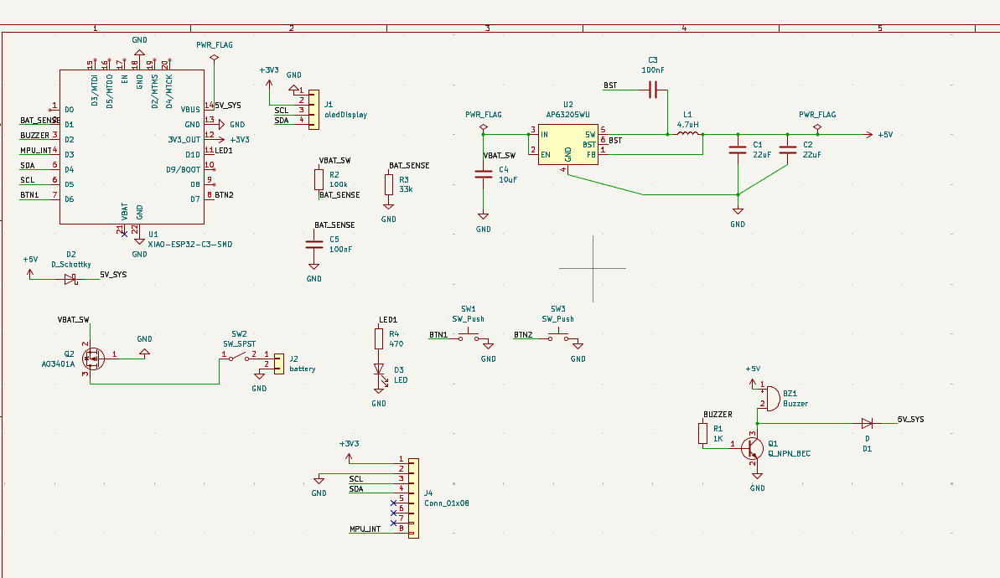

I learnt that when using an ADC divider I need to calculate for the maximum voltage the battery can have. I also need to make sure all parts of the circuit use the same net name when the power source changes.

# 2026-11-10: Clean up Schematic and Perform Initial ERC Check

**Total time spent: 3 hours**

Returning to the BUZZER section I corrected the power issue. The positive pin was still connected to +5V and the cathode of the flyback diode was connected to 5V_SYS. Both should be on the same rail. I moved the BUZZER pin to be on the 5V_SYS rail. This is connected to the VBUS pin of the XIAO.

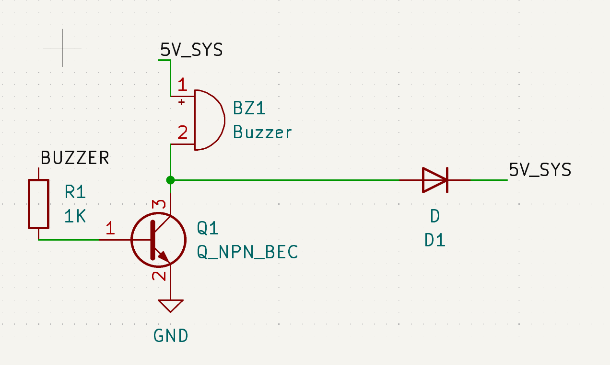

No-connect flags were added to the XIAO pins that were intentionally left unused. This includes the boot, JTAG, EN, VBAT and D0 pins. I also added the missing power flags. These don’t affect the circuit but let KiCad know that these connections are intentional. Or that a rail is being powered externally.

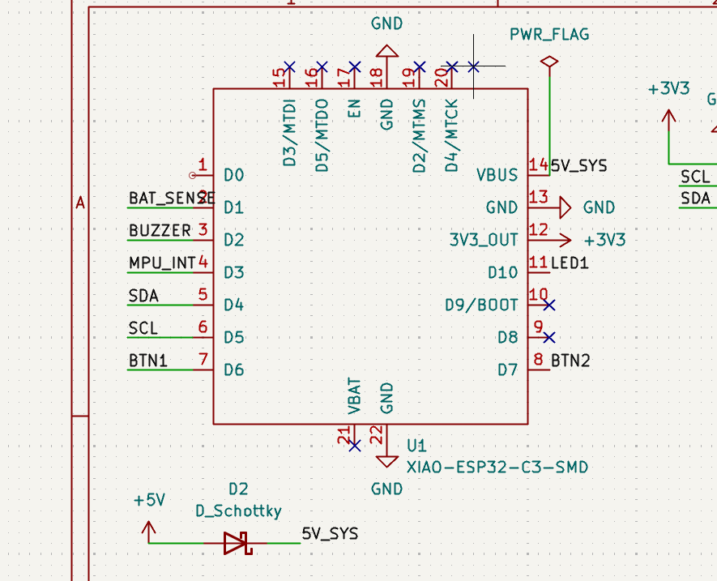

The initial check highlighted 3 issues. One of the pins (D0) wasn’t connected. I had forgotten to add the no-connect flag. There were also 2 issues with the power input. The nets didn’t have a power output pin recognised by the ERC. I added the missing no-connect flag and added PWR_FLAG symbols to the power nets.

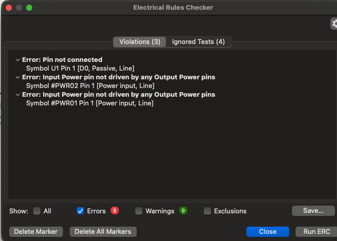

After the changes were made the ERC was run again. Zero issues were found. A clean ERC was achieved.

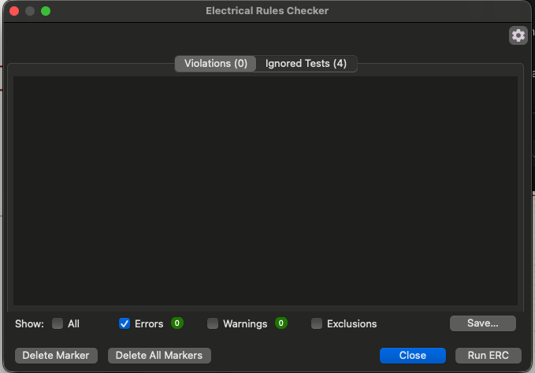

I still manually checked the schematic. The ERC only checks the electrical rules. It won’t know if everything has been done correctly with the design. For example if a net has a typo or the wrong power rail it may not highlight it.

The XIAO, OLED connector, GY-521 connector, AP63205 Buck circuit, battery connector and switch, P-Channel reverse polarity protection, battery divider, Schottky diode, BUZZER driver, 2 buttons and status LED have been added. Now the footprints can be assigned and the design moved to the PCB editor.

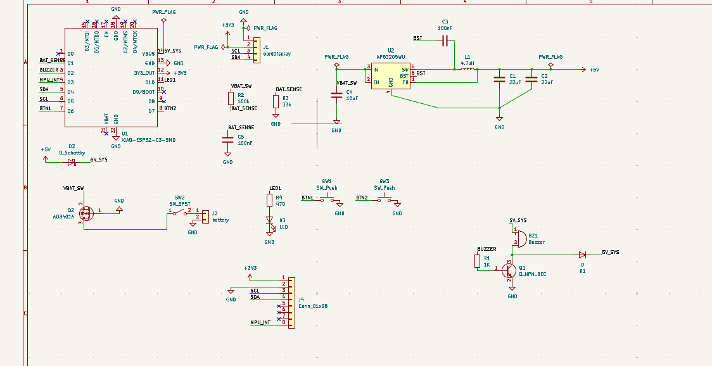

I learnt that a clean ERC is useful but doesn’t guarantee the circuit is correct. I still need to check the schematic against the datasheets. All nets need to be checked and the actual pinout of the components.

# 2026-11-10: Assign Footprints and Import PCB

**Total time spent: 4 hours**

With the schematic looking cleaner the Assign Footprints tool was opened. Most of the components didn’t have footprints assigned. The footprint browser initially looked as if there weren’t many options available. Eventually I realised the filters were enabled and there was an old text filter. The filters were cleared and the library search started showing the correct footprints.

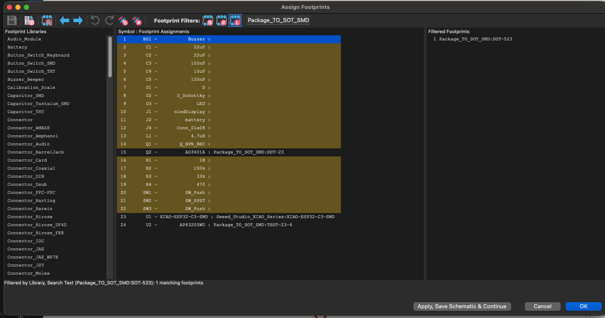

I chose footprints that could be easily hand soldered. Most of the passive components would be either 0805 or 1206. Through hole headers/connector footprints were used for easy soldering/connecting to the modules. The components selected were:

XIAO ESP32-C3 footprint, AP63205 TSOT-23-6 footprint, Transistor & MOSFET in SOT-23, OLED & GY-521 connector sockets, JST-PH battery connector, Buzzer, Inductor, Resistors, Capacitor, Diode & LED, Switch.

Two pin switch connection kept using header footprint as the schematic symbol has two pins. Battery connector must match the actual connector on the pack. Buzzer pins and inductor land pattern should be checked.

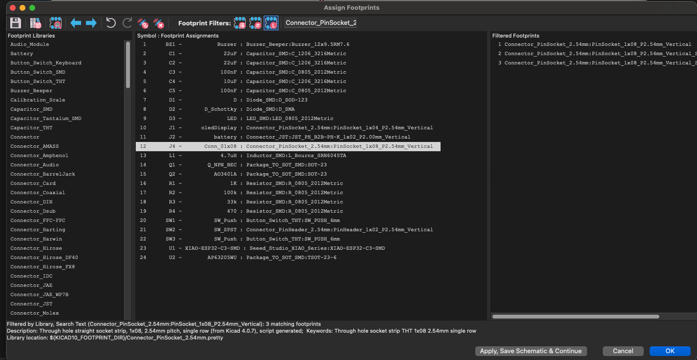

Using the 'Update PCB from schematic' command in KiCad the components and net connections were generated in the PCB editor. There were no warnings/errors. The footprints appeared in the PCB editor and ratsnest lines highlighted what needed to be connected.

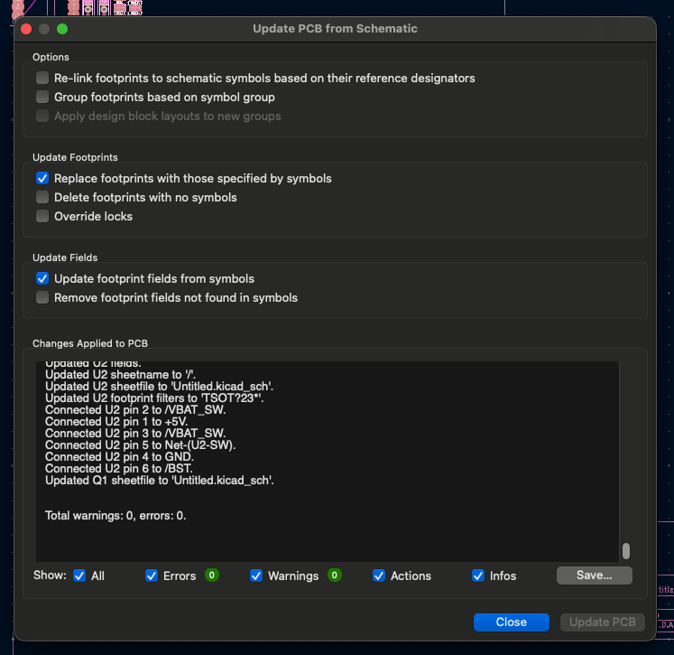

The footprints imported into the PCB editor were arranged in a long line. The 3D viewer was used to get a rough idea of where the components were laid out. This meant I could get an idea of where the larger components would be and where to place the connectors, display socket, sensor socket, buttons and buzzer.

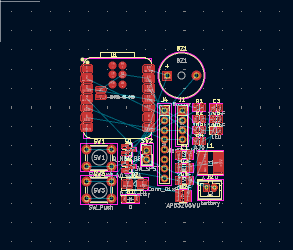

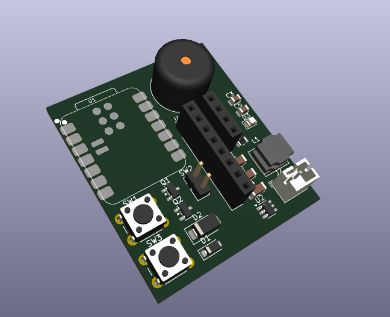

Before ordering each footprint needs to be verified to match the actual component. The order of pins on the socket, AO3401A pinout, spacing between pins on buzzer, JST connector, inductor land pattern and XIAO antenna spacing should be checked. The library footprint is only a guide until they are compared to the exact component.

Learned: When assigning footprints you need to ensure they match the dimensions, pin numbers and connector orientation.

# 2026-11-10: Component placement, board outline & initial routing

**Total time spent: 2 hours**

The footprints have been added to the PCB editor. The components have been organised based on their function. The XIAO has been placed on the left-hand side of the board with the OLED & MPU sockets nearby. The buttons have been placed together on the right-hand side. The buzzer and transistor have been placed together near the top right. The battery connector and switch header have been placed near the bottom of the board. Lastly the buck converter components have been grouped together so the connections stay short.

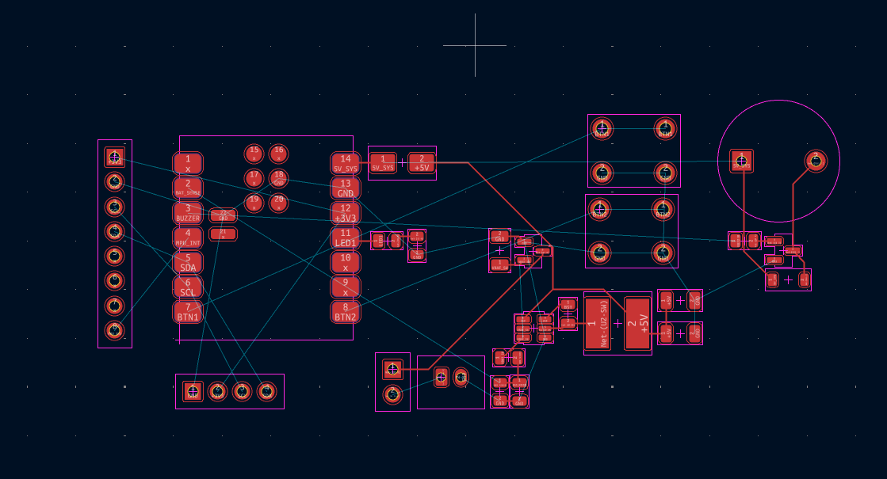

An initial outline of the PCB was created using the Edge.Cuts layer. This gives us a set area to work with. I have also started to route the buzzer section of the PCB. The transistor, buzzer and flyback diode are all a small group of connections.

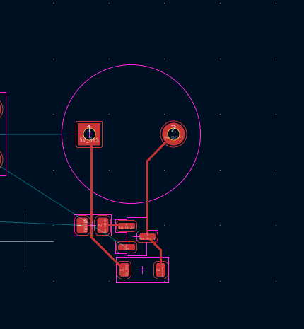

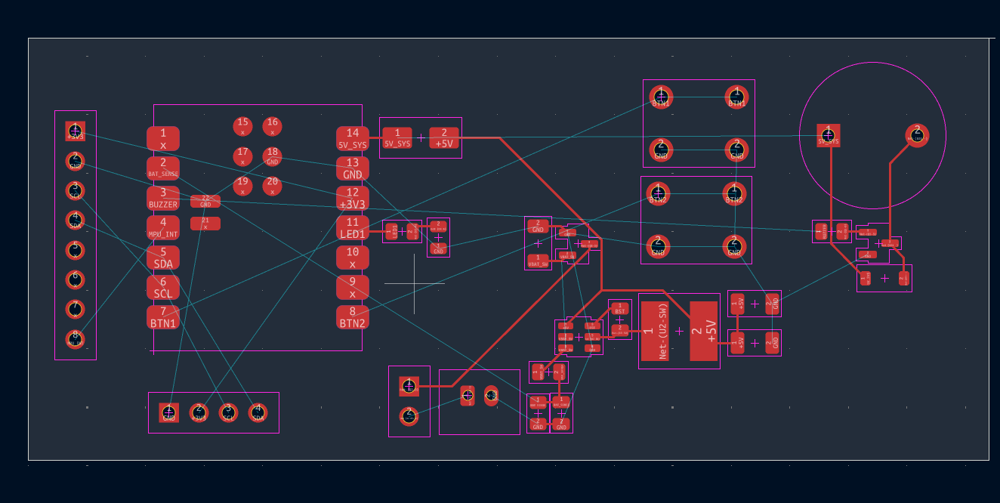

The traces were added to the F.Cu and B.Cu layers. Where there were connections crossing over each other, I have used a via to move to the other copper layer. This was a very simple routing to help identify where the rest of the connections would go. It has also helped identify where the routing was difficult due to component placement.

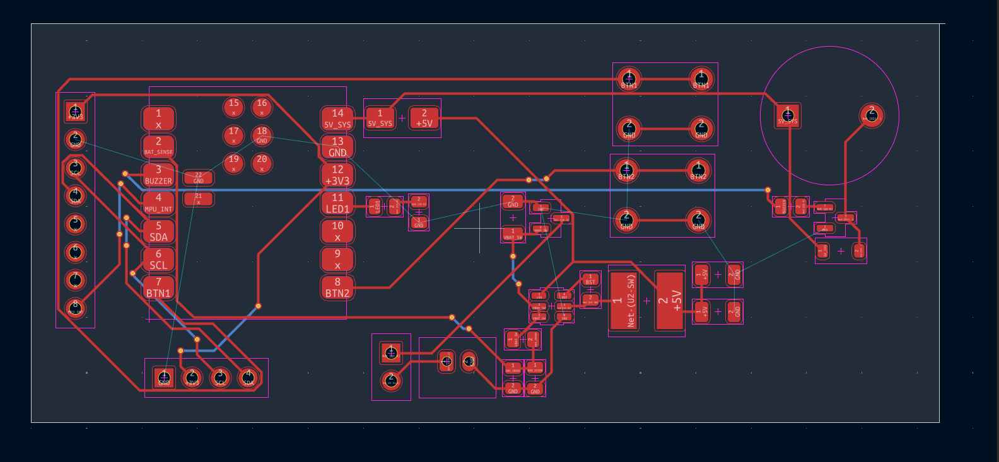

Rather than adding traces to connect all the grounds I have added two ground areas to the front and back copper layers. A clearance of 0.5mm was set, minimum width 0.25mm, and thermal relief connections were used for the pads. Remove islands was also turned on to remove any stray copper.

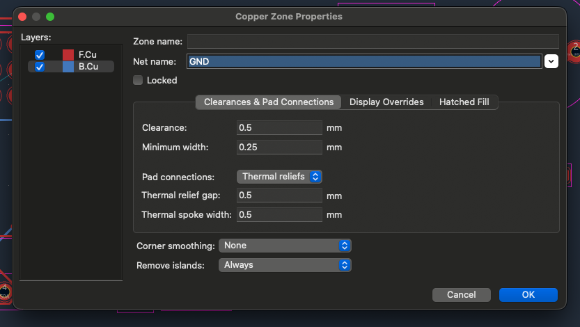

The PCB now has ground connections on both sides of the board with clearances around the traces. The ground areas will need to be filled once any more changes are made.

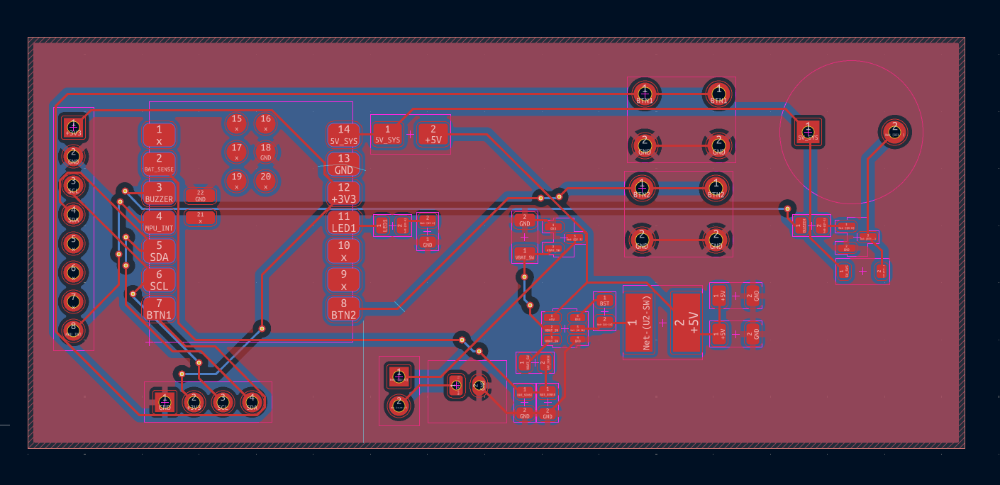

At the end of this stage there are 86 pads, 16 vias, 136 segments and 32 nets. There are still 4 connections to be routed. I will leave these for the next session. The power traces, buck converter and XIAO antenna areas need a closer look.

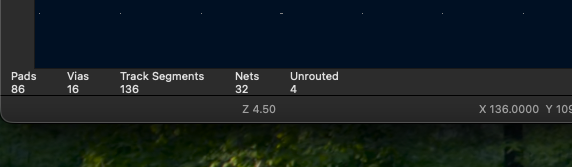

Learned: Component placement can make routing difficult. Ground areas need to be filled after any changes. The number of connections to route is a quick indicator of how many connections are left.

# 2026-11-10: Final routing & DRC error

**Total time spent: 5 hours**

Continuing from the last session. The remaining 4 connections were completed. The ground areas were filled. The status bar now indicates there are 0 connections to route. There are 86 pads, 20 vias, 145 segments and 32 nets. Four more vias and nine more segments have been added since last session.

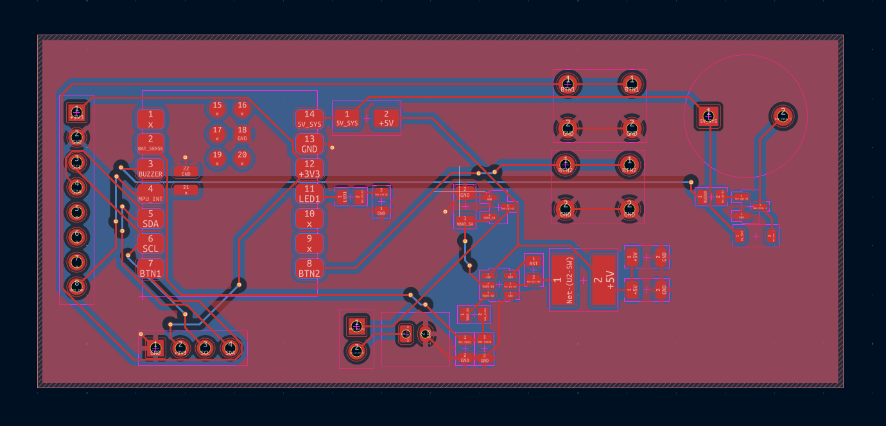

I have viewed the PCB in 3D to check how it looks from the top and bottom. This can help identify component placement and how it will look. It has given me a good idea of how the sockets, buzzer, battery connector and buck converter components are placed. The bottom of the PCB mainly has ground areas with through hole pins and fewer traces.

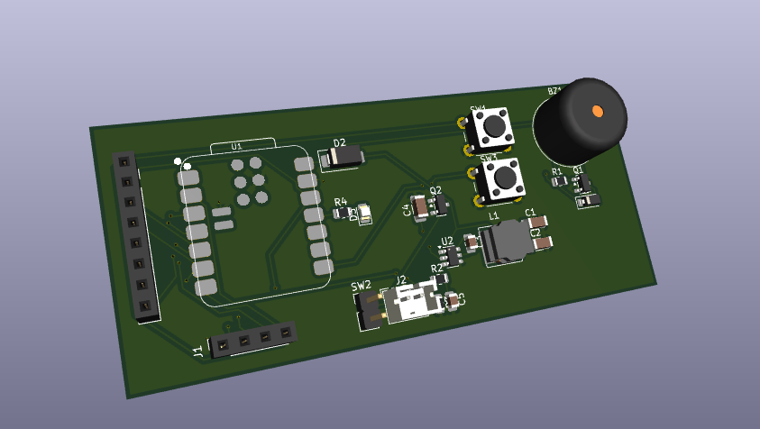

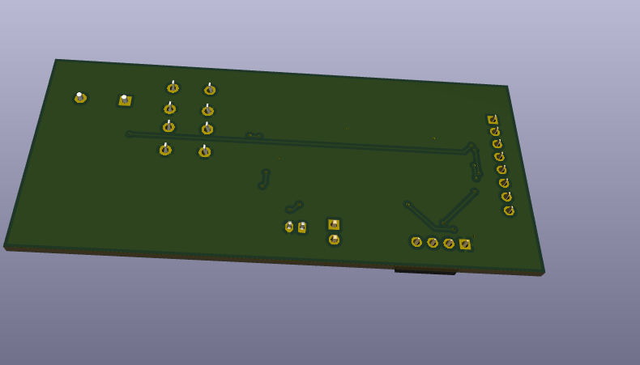

Running the Design Rules Checker. I have turned on fill areas. There was 1 error and 29 warnings. The number of unrouted/unconnected has already been reduced to 0. This means the routing is complete. The error came from the J4 sensor header. Pad 2 is using thermal relief to connect to ground. There was only one spoke connecting to the ground area. The board rule requires at least two spokes.

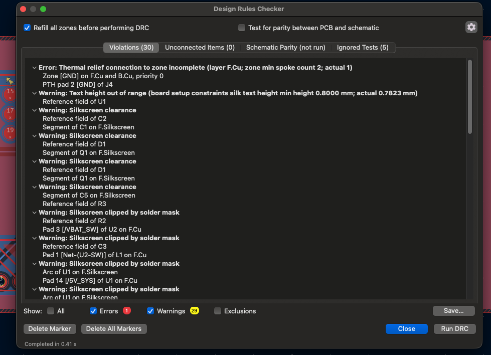

I attempted to add another spoke to connect pad 2 to the ground area however there wasn’t enough space. I have added a short trace connecting the pad directly to a nearby ground via.

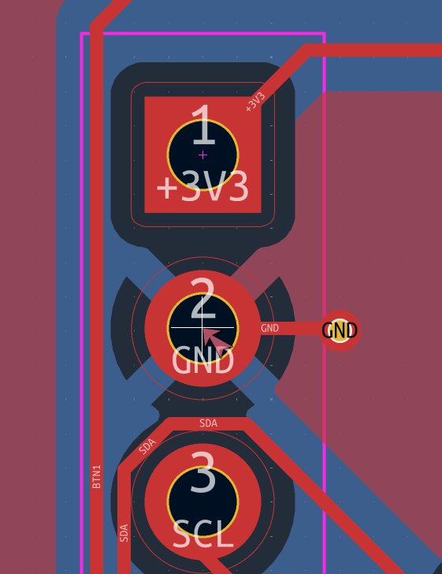

The Design Rules Checker now shows 0 errors. There are still 29 warnings. All warnings are related to the silk screen. Text is slightly too small, reference labels are too close to other footprints and some lines overlap the solder mask cut outs. A visual check would still be needed.

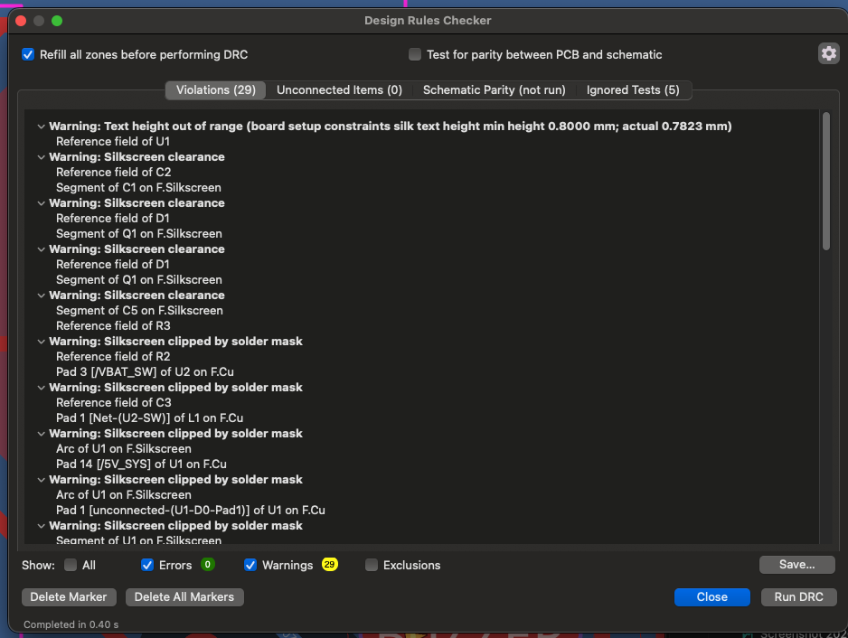

The schematic parity check option wasn’t turned on. This means the 0 error doesn’t mean it matches the schematic.

Learned: The PCB may have 0 connections to route but still fail DRC. I have learnt how to overcome the crowded thermal relief connection by adding a direct trace to a ground via. There are still warnings and no schematic parity check.

# 2026-11-10: Board shape & mounting holes

**Total time spent: 3 hours**

Looking at the 3D view, I noticed the USB-C connector on the XIAO needed to be accessible. I moved the module up to the top of the board. The outline was altered to add a cut out at the end of the connector. All four corners were rounded to give a better shape.

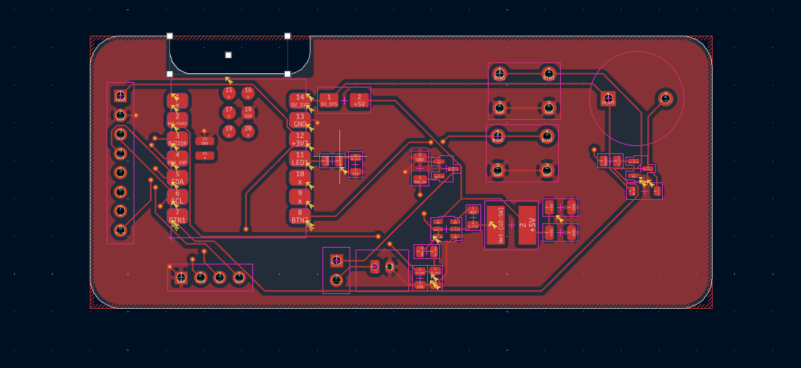

The silk screen was viewed to show where the reference labels and components would be. This helped identify how the board would look when printed. All the components (OLED, MPU Socket, Buttons, Buzzer & Power section) could be seen.

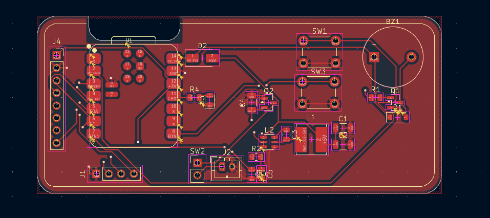

Four mounting hole symbols were added to the schematic. Each was assigned a M3 mounting hole footprint with a 3.2mm hole. Non plated mounting hole was selected as the screws don’t need to connect electrically.

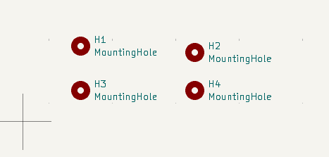

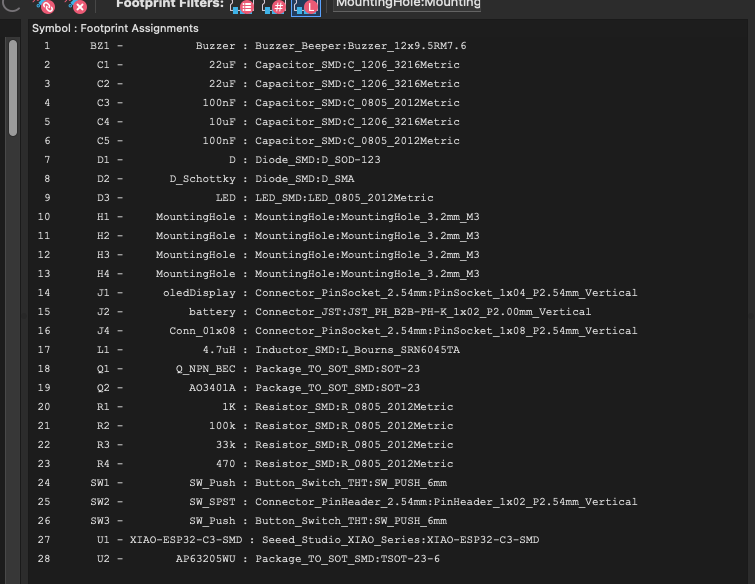

The PCB was updated using the 'Update PCB from schematic’ command. The 4 mounting holes were added with no warnings/errors. The mounting holes were placed in their intended positions. They were placed away from the buzzer and USB cut out. The mounting hole positions will help identify where to place the enclosure posts and back plate.

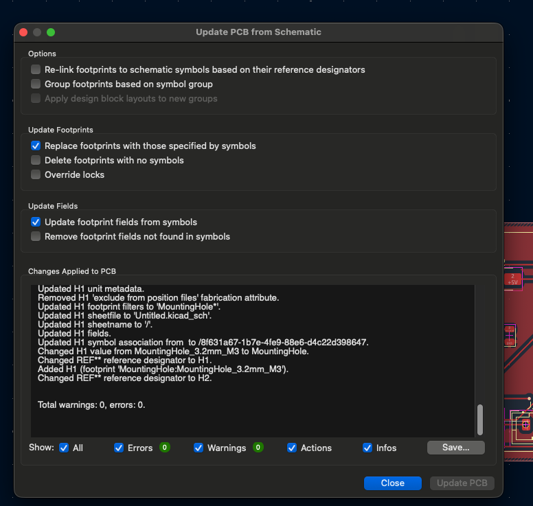

I viewed the top and bottom of the PCB to ensure the outline and mounting holes looked as expected. The top shows the USB cut out, rounded corners and component layout. The bottom shows the ground area, through holes and mounting holes.

The DRC needs to be run again with schematic parity enabled. The USB cut out and antenna spacing need to be checked. The pin orientation of the connectors and mounting holes need to be checked to ensure they match the enclosure.

Learned: The mounting holes should be added to the schematic. The mounting holes were also added to the PCB. The outline has caused changes to the copper areas and clearances so the DRC needs running.

# 2026-11-10: CAD enclosure design

**Total time spent: 6 hours**

The PCB outline and mounting holes were created. The PCB was exported from KiCad as a 3D model and imported into CAD. This has given me the actual shape of the board, location of the holes and height of the components.

I started with a back plate with a lip and cut out for the PCB. The four mounting holes were aligned with the M3 holes on the board. The holes need to be aligned correctly, otherwise it would make the assembly difficult or cause stress on the board when tightening.

The PCB was placed onto the back plate. The 0.96 inch OLED model was added so I could see how it would sit. The height of the sockets and taller components were considered. The case needs to give the components enough internal space.

The PCB, back plate and housing were exploded to see the order of the parts. An assembled version was also created so I could see where the OLED would go and how the back plate would look with the screw posts showing through.

The general case shape and back plate are now in place. The USB-C connector needs a cut out in the wall. The buttons and power switch need to be accessible from the outside. The buzzer needs a cut out to allow the sound to come out. There needs to be space for the 2S battery and JST connector. A window needs to be added for the OLED. The actual OLED and GY-521 modules also need to fit into the sockets.

The screw posts, spacers and holes need to be checked to ensure they are all aligned. I have CAD models and exported files in the repository however I need to ensure they actually fit.

Learned: Having the PCB imported as a 3D model has made designing the enclosure much easier. The case size depends on the size of the board, connector access and component heights.

# 2026-11-10: Firmware setup & 3 test sketches

**Total time spent: 2 hours**

I have broken the firmware down into small sketches to test the basic pins and peripherals. This will help identify a problem with one section of the board if it doesn’t work.

There are 9 sketches in the firmware folder. The first few are testing the basic pins, I2C and OLED display. Later sketches are testing animations, buzzer, buttons, MPU-6050, auto rotation, battery monitoring and the full timer demo.

This sketch is a simple GPIO test. It uses serial communication, blinking the status LED on D10 and reading the buttons on D6 and D7. The pins are listed at the top to easily compare to the schematic. This will help identify any issues with the pin mapping/wiring.

The OLED and GY-521 modules use the same I2C bus. They are connected to D4 (SDA) and D5 (SCL). This sketch scans for I2C addresses. Any devices found will be listed. The OLED should be found at address 0x3C and the MPU-6050 module at address 0x68. If one isn’t found when testing I will need to check the orientation of the module, pin order of the socket, power and I2C connections.

This sketch uses the U8g2 library to test the 128x64 SSD1306 OLED. It contains simple text and shapes, progress bars, rotation, large clock and changing brightness. This was created as a test to ensure the display library is working and the layout is correct.

The sketches have been organised in the firmware folder. The images below show the previous layout. The sketches have been moved into one folder with numbered .ino files.

Notes from Arduino IDE: Installed ESP32 board, Selected XIAO ESP32-C3, USB CDC enabled on boot, Installed U8g2. No source notes for this section.

Learned: Testing each peripheral makes the bring up easier. Separated the code being written from the code being compiled, uploaded and verified.

# 2026-11-10: OLED animations, buzzer, buttons & status LED

**Total time spent: 2 hours**

With the basic display working, I have created a sketch to run six different animations on the OLED. The animations are a bouncing ball, spinner, countdown ring, scrolling text, tomato and sine wave. BTN1 is used to change to the next animation. BTN2 is used to cycle through the three speed modes (0.5x, 1x & 2x). The animation title is displayed so it is easy to see what is being run.

The animations use the millis() function to calculate the time step. The buttons are read, time is calculated and the animation is updated. The display buffer is sent. This should keep the animation speed consistent.

A separate test was created for the buzzer and status LED. There are four simple tunes to choose from. The tunes are start, alarm, break and a short happy tune. The tunes are stored in an array containing the note frequency and duration. Short and long button presses are used. This will also be useful for the main timer interface.

BTN1 is used to cycle through the tunes using short presses. BTN2 is used to cycle through the LED patterns (off, on, slow blink, fast blink, heartbeat & breathing) using short presses. BTN1 can be held to turn the LED off. The buzzer is played without using delay() so the loop can constantly check buttons and update the OLED.

3. Things to Test

This requires a passive buzzer as active buzzers usually have a fixed frequency. If no sound is heard then there may be a problem with the transistor driver and/or polarity of the diode. The LED blink pattern will rely on the PWM working on D10.

These are included in the firmware folder. However, I’ve yet to verify any pictures of the circuitry and test results from the actual board. This will be something I’ll need to look into later.

I’ve learnt that by using non-blocking timing we can get all our audio, button inputs and display updates working together. Also using a low debounce time helps prevent repeated button presses.

# 2026-11-10: MPU-6050 Configuration + Auto Rotate

**Total time spent: 2 hours**

The new sketches focus on the GY-521 motion sensor. Sketch 05 uses I2C to talk to the MPU-6050 at address 0x68. We then configure the register with various different options such as power management, accelerometer range, gyroscope range, filtering, sampling, motion threshold and interrupt. We also have scaling values for each range.

We have buttons to change the accelerometer range (BTN1), filter (BTN2). BTN1 can be pressed long to toggle between showing the numerics or bubble level on the OLED. The Serial output displays the accelerometer in g, gyroscope in degrees per second, roll, pitch and temperature. There is also a comma separated option for the Serial Plotter.

Sketch 06 is the main auto rotate functionality. The Orientation class is used to determine the gravity direction of the sensor then calculate how the user is holding the timer. As the GY-521 module can be used in any orientation we added a calibration wizard to ensure we know which way is up.

The wizard asks for a few known positions then stores the directions for up, right and front. The calibration is stored into the ESP32 flash using preferences so we can load it again after a restart. We use the rotationFor() function to map the orientation detected to the four rotations.

The loop constantly updates the orientation of the sensor and rotates the display when a new position is detected. Holding both buttons for 3 seconds will clear the stored calibration and start the calibration wizard again. This orientation data is also used to determine if the timer is upside down or not which is required for the main demo.

We still need to run the code with the actual module. We need to ensure we can rotate the display in all 4 orientations, check the physical orientation of the vertical socket and test the motion interrupt on D3. Even if the interrupt doesn’t do what we expect the polling should still let us test this functionality.

I’ve learnt that we don’t need to use the gyroscope to get the basic orientation information from the accelerometer. It is useful to calibrate the unit as we won’t always know how it is physically oriented.

# 2026-11-10: Battery Monitoring + Full Pomodoro Demo

**Total time spent: 2 hours**

We added a new sketch to monitor the battery. The voltage from the voltage divider on D1 is read. The voltage divider has a 100kΩ resistor at the top and 33kΩ at the bottom. We read the voltage on the ADC then scale it back up using the ratio of the resistors to give us an estimate of the total voltage of the pack. As the battery is a 2S pack we divide this by 2 to give us the voltage per cell.

We then estimate the percentage of battery left based on a small curve of voltages for a lithium cell between 3.0V and 4.2V per cell. We’ve added a low battery threshold at 6.6V and a calibrate value that can be changed once we’ve compared to a multimeter. The setup section sets the ADC to the correct attenuation and initialises the OLED, LED, buttons and buzzer. The loop updates the battery every second. If there is a low battery it will turn the LED on and play a short warning on the buzzer. If the ADC is very low it’ll show that it is only being powered via USB.

The final sketch brings together all the main functionality of the Pomodoro timer. The timer has 3 sections: Focus (25min), Short Break (5min) and Long Break (15min after 4 focuses). This also brings together the buzzer, status LED, battery monitor and auto rotate.

In the demo version we set SECONDS_PER_MINUTE to 3 so we can simulate a 25min focus time in 75 seconds. This will help us test the timer flow without having to wait for 25 minutes. We need to change this back to 60.

The loop updates the orientation, rotates the screen when needed and checks if the device is upside down. If FLIP_TO_FOCUS is enabled we’ll start the session when we turn the timer upside down and pause when we turn it back. When upside down the screen is set to power save mode. The timer, LED, battery and display are updated.

The buttons are BTN1 to start/pause, BTN2 to skip a session. BTN2 can be pressed long to reset. Holding both buttons for 3 seconds will re-calibrate the orientation.

We can see the sketches and the full demo code in the source notes however we haven’t fully tested it on the actual board. We need to compare the battery to a multimeter, adjust the calibrate value, double check the resistor values, test low battery warning and buzzer volume. We also need to change SECONDS_PER_MINUTE back to 60.

I’ve learnt that the battery percentage is just an estimate based on the voltage. The final demo relies on many different features so we need to properly test it on the built hardware.

Development Status + Things to do

The schematic was fully completed with no errors or warnings from ERC. The PCB was routed with no un-routed connections and had no errors from DRC. However we still need to check the silk screen warnings and schematic parity. The case was started and the firmware sketches created. However we still need to:

Check the exact footprint of the components and pinout of modules.

Double check the PCB matches the schematic.

Run DRC again once we’ve finished the final outline and mounting holes.

Clean up the silk screen.

Ensure there is clearance for the USB and antenna.

Check the cut outs and fit of the case.

Test the firmware on the actual board.

Compare the battery monitor to a multimeter.

Change the timer back to real minutes from the speeded up demo.