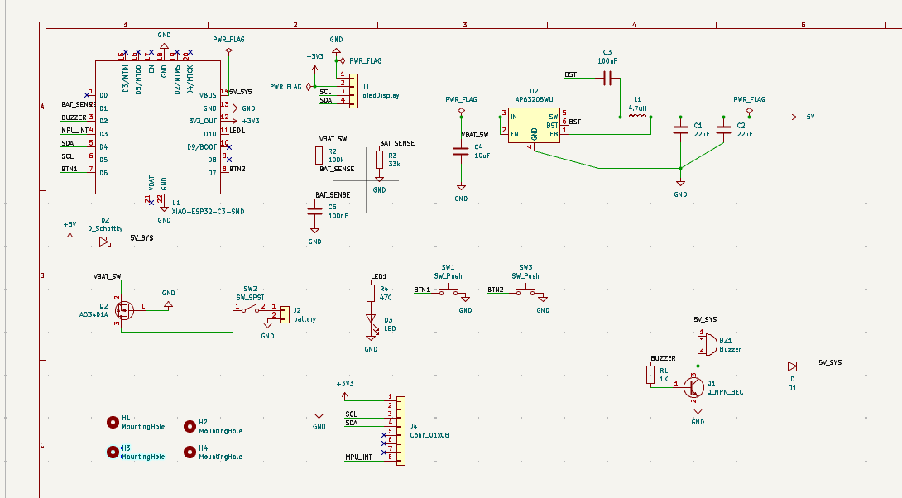
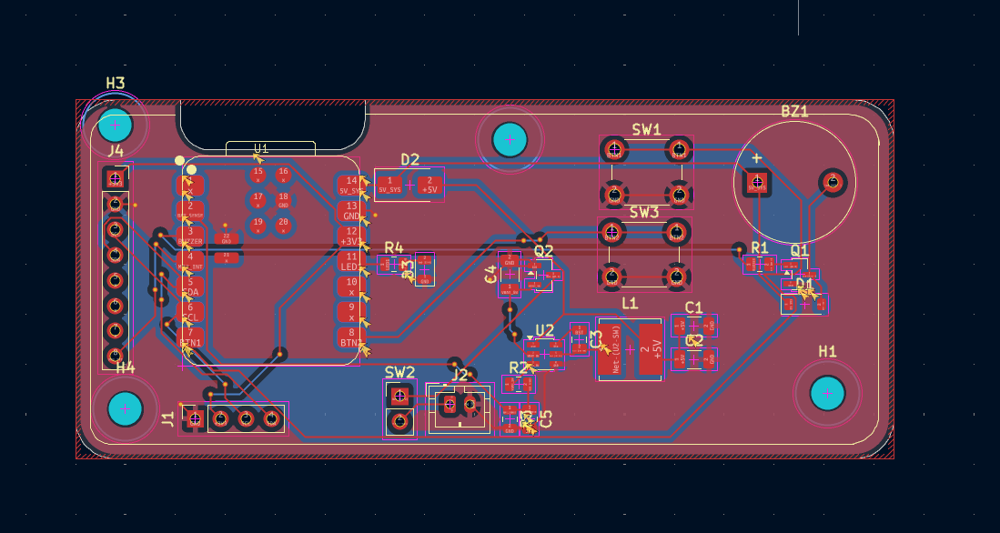
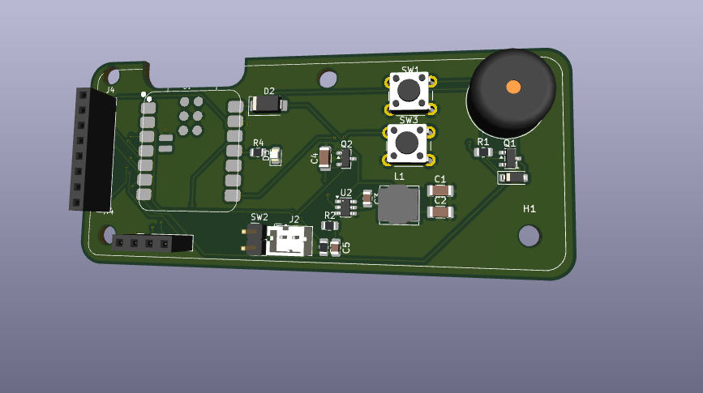
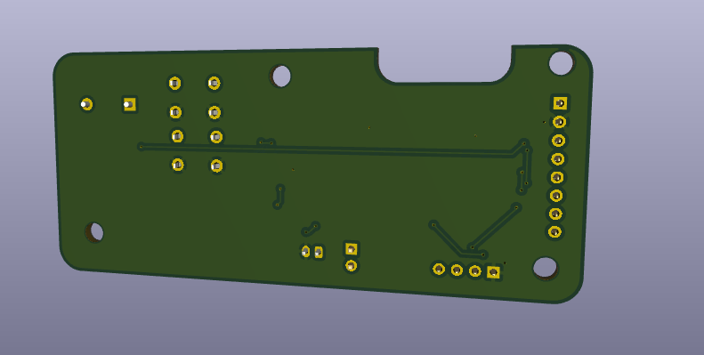
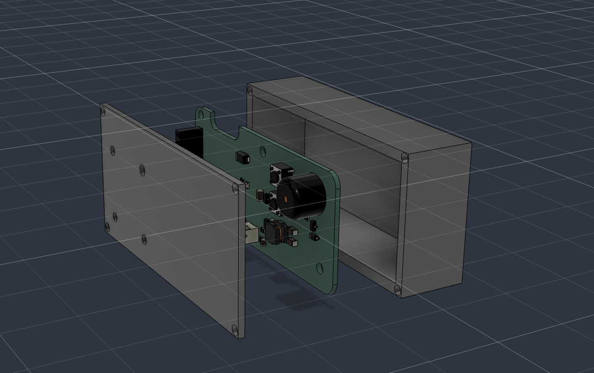
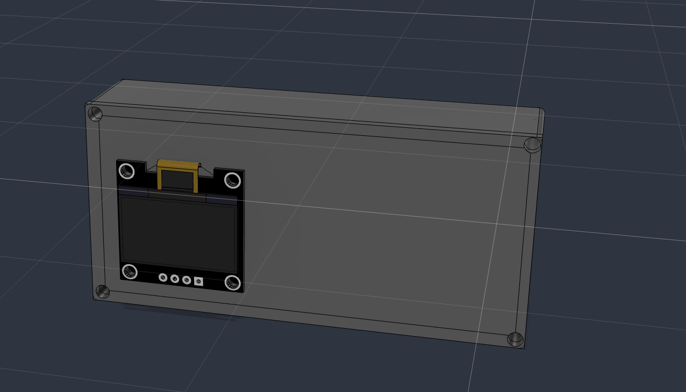
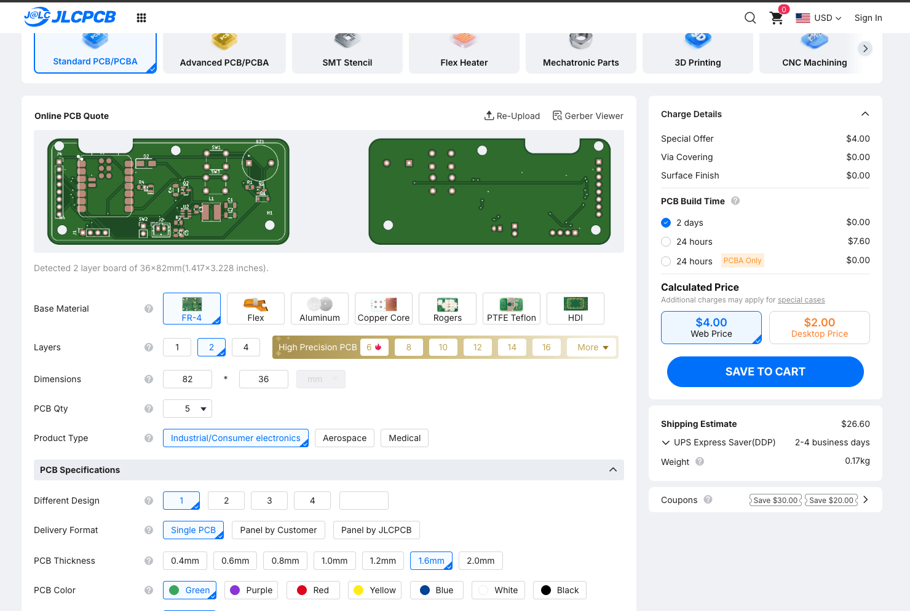

# Poromodo Timer

A mini pomodoro timer powered by a battery. This was designed using KiCad to create a custom PCB. A small case was designed to house the timer board, OLED and movement sensor. The aim of this project is to create an easy to use and easy to build timer that can rotate the display depending on how it is held.

The design includes a 2S Li-Ion battery, 5V buck converter, 0.96 inch OLED and GY-521 module with MPU-6050. The XIAO manages the timer logic and provides Wi-Fi and Bluetooth Low Energy for future features.

## How it works

The battery pack provides approximately 7.4V (8.4V fully charged). This is passed through a power switch and P Channel MOSFET anti polarity protection circuit, then into a 5V Buck converter (AP63205). A Schottky diode is used to feed the 5V rail to the XIAO's VBUS pin. This also helps to prevent USB power being fed into the Buck Converter.

The XIAO has an onboard regulator that provides a 3.3V rail to provide power to the OLED and GY-521 motion sensing module. The OLED uses I2C to communicate with the XIAO. The MPU-6050 uses the same I2C line to send orientation data. This can be used by the firmware to rotate the display. A resistor divider is used to step down the battery voltage to be passed to the ADC. The buttons, status LED and buzzer are all connected to individual GPIO pins. The buzzer is turned on using an NPN transistor.

```text
[ 2S Li-ion Battery ]
          |
          v
[ Power Switch + Reverse-Polarity Protection ]
          |
          v
[ AP63205 Buck Converter ] -- 5 V --> [ Schottky Diode ]
                                               |
                                               v
                                      [ XIAO ESP32-C3 ]
                                         |         |
                                      3.3 V       GPIO / ADC
                                         |         |
                             +-----------+         +------------------+
                             |           |         |        |         |
                             v           v         v        v         v
                          [ OLED ]   [ GY-521 ] [ Buttons ] [ LED ] [ Buzzer ]
                              \\___________ I2C ___________//
```

## Main features

Seeed XIAO ESP32-C3 (Wi-Fi + BLE) micro controller module
2S Li-ion battery input
AP63205 5V buck converter
AO3401A P-channel MOSFET used for reverse polarity protection
0.96" 128x64 SSD1306 I2C OLED display
GY-521 MPU-6050 accelerometer and gyroscope module
Resistor voltage divider for battery sensing
Two buttons for user Input
Status LED
Passive buzzer controlled by transistor
Double sided PCB around 36x82mm
Two part 3D printable housing


## Images

### Schematic



### PCB layout



### PCB 3D view





### Enclosure





### PCB quotation



## Assembly guide

The design data, manufacturing data, and housing designs can be found here. Before assembly ensure that component footprints match, and that the pin layout of the connectors matches the OLED and GY-521 modules you have. Different variants may show different pin outs.

PCB Preparation: Order the PCB by using gerber.zip, or each file in gerber/. Ensure that the board outline, drilling and layer detection all look correct.
Board Inspection: Check the board has no obvious damage. Check the pads, connectors, and solder mask. Check for any unexpected short circuits using a multi-meter.
Power Assembly: Construct the battery input, AO3401A protection circuit, AP63205 regulator, inductor, and associated capacitors. Ensure that the MOSFET and regulator are placed correctly (Check pin out of MOSFET and regulator from datasheet).
XIAO Module: Place the module onto the PCB ensuring that the module matches the footprint on the PCB. Check all solder joints. Ensure there are no solder bridges between adjacent pads.
Connector & Peripheral Assembly: Attach the OLED and GY-521 sockets, buttons, LED, buzzer, and battery connector. Check the header pins on the OLED match GND, 3V3, SCL, SDA. Check this matches the display module you have.
Power Rails: Double check everything looks good. If possible use a current limited bench PSU to ensure that the 5V and 3.3V rails are correct.
Housing Assembly: The housing can be found in the 3d/ directory. This contains STEP assembly, Fusion 360 archive, and print ready STLs. Have a test fit of the PCB and OLED. The holes are designed to take M3 hardware.
Battery Connection: Use an appropriate 2S protected battery pack. Ensure you use a proper 2S charger. A fully charged 2S battery will be 8.4V. The XIAO will not use the 1 cell battery input.


## Firmware upload

The `firmware/` directory contains separate Arduino sketches. They are intended to be uploaded one at a time while bringing up and testing the board.

| Sketch | Purpose |
|---|---|
| `01_hello_pins.ino` | Basic GPIO and pin checks |
| `02_i2c_scanner.ino` | Scan the I2C bus for connected devices |
| `03_oled_basics.ino` | Basic OLED initialization and display test |
| `04_oled_animations.ino` | OLED animation tests |
| `05_mpu_config.ino` | MPU-6050 configuration and sensor readings |
| `06_auto_rotate.ino` | Display rotation based on sensor orientation |
| `07_buzzer_buttons_led.ino` | Test the buzzer, buttons and status LED |
| `08_battery_monitor.ino` | Read the battery-voltage divider using the ADC |
| `09_pomodoro_demo.ino` | Combined Pomodoro timer demonstration |

### Upload steps

Install the Arduino IDE.
From within the Boards Manager, install the ESP32 board package from Espressif.
Connect the XIAO ESP32-C3 via USB data cable.
Open one of the .ino files located in firmware/.
Select the board type as XIAO_ESP32C3 and select the correct serial port.
Ensure that all libraries required by the sketch have been installed. These can be seen at the top of each source file.
Click the verify button to compile the sketch. Then click upload.
If the sketch uses serial output, open the Serial Monitor and select the baud rate set in the sketch.

We will start by using 01_hello_pins.ino. Once we know that the I2C and OLED are working we can move onto the sensor and full demo. Each of these are individual test programs so uploading a new sketch will overwrite the previous firmware on the XIAO.

## Repository contents

```text
.
├── 3d/              # STEP assembly and printable enclosure files
├── firmware/        # Arduino test sketches and Pomodoro demo
├── gerber/          # PCB Gerber and drill files
├── gerber.zip       # Fabrication upload archive
├── images/          # Main project images
├── kicad/           # KiCad schematic and PCB project
├── bom.csv          # Component list, prices and purchase links
└── README.md
```

## Components and BOM


| Qty | Component | Unit price (USD) | Total (USD) | Buy | Notes |
|---:|---|---:|---:|---|---|
| 1 | XIAO ESP32-C3 (U1) | $5.39 | $5.39 | [RobotShop](https://www.robotshop.com/products/seeedstudio-xiao-esp32c3-tiny-mcu-w-wi-fi-ble) | Seeed XIAO ESP32-C3 board only. Price checked on seller page. |
| 1 | AP63205WU-7 buck converter, 5 V 2 A, TSOT-26 (U2) | $0.25 | $0.25 | [LCSC](https://www.lcsc.com/product-detail/C2071056.html) | LCSC starting price; small quantities may cost more. |
| 1 | Inductor 4.7 µH, Bourns SRN6045TA-4R7M (L1) | $0.60 | $0.60 | [DigiKey](https://www.digikey.fi/en/products/detail/bourns-inc/SRN6045TA-4R7M/6155104) | Listed as out of stock with an 18-week lead time. Use a compatible shielded 4.7 µH inductor with the same land pattern. Estimate; check at checkout. |
| 2 | Capacitor 22 µF 25 V X5R 1206 (C1, C2) | $0.0595 | $0.12 | [LCSC](https://www.lcsc.com/product-detail/C12891.html) | Samsung CL31A226KAHNNNE. LCSC starting price. |
| 1 | Capacitor 10 µF 1206 (C4) | $0.05 | $0.05 | [LCSC search](https://www.lcsc.com/search?q=10uF+1206+25V+X5R) | Use 16 V or higher. Estimate; check at checkout. |
| 2 | Capacitor 100 nF 0805 (C3, C5) | $0.01 | $0.02 | [LCSC search](https://www.lcsc.com/search?q=100nF+0805+50V) | Often sold in packs. Estimate; check at checkout. |
| 1 | Resistor 1 kΩ 0805 (R1) | $0.01 | $0.01 | [LCSC search](https://www.lcsc.com/search?q=1k+0805+resistor) | Estimate; check at checkout. |
| 1 | Resistor 100 kΩ 0805 (R2, battery divider top) | $0.01 | $0.01 | [LCSC search](https://www.lcsc.com/search?q=100k+0805+resistor) | Estimate; check at checkout. |
| 1 | Resistor 33 kΩ 0805 (R3, battery divider bottom) | $0.01 | $0.01 | [LCSC search](https://www.lcsc.com/search?q=33k+0805+resistor) | Estimate; check at checkout. |
| 1 | Resistor 470 Ω 0805 (R4) | $0.01 | $0.01 | [LCSC search](https://www.lcsc.com/search?q=470+ohm+0805+resistor) | Estimate; check at checkout. |
| 1 | Schottky diode SS34, SMA (D2) | $0.05 | $0.05 | [LCSC search](https://www.lcsc.com/search?q=SS34) | Estimate; check at checkout. |
| 1 | Diode 1N4148W, SOD-123 (D1, buzzer flyback) | $0.02 | $0.02 | [LCSC search](https://www.lcsc.com/search?q=1N4148W) | Estimate; check at checkout. |
| 1 | LED 0805 (D3) | $0.03 | $0.03 | [LCSC search](https://www.lcsc.com/search?q=led+0805) | Estimate; check at checkout. |
| 1 | NPN transistor MMBT3904, SOT-23 (Q1) | $0.02 | $0.02 | [LCSC search](https://www.lcsc.com/search?q=MMBT3904) | Estimate; check at checkout. |
| 1 | P-MOSFET AO3401A, SOT-23 (Q2) | $0.10 | $0.10 | [LCSC search](https://www.lcsc.com/search?q=AO3401A) | Estimate; check at checkout. |
| 1 | Passive buzzer 12 × 9.5 mm, Soberton WT-1209T (BZ1) | $1.15 | $1.15 | [DigiKey](https://www.digikey.com/en/products/detail/soberton-inc/WT-1209T/16384509) | Check the datasheet for the 7.6 mm pin pitch before ordering. Price checked on seller page. |
| 1 | GY-521 MPU6050 module (J4 socket) | $3.79 | $3.79 | [OpenELAB](https://openelab.com/products/mpu6050-gy521-six-axis-sensor) | Listed as sold out / pre-order (10–20 working days). Check other sellers. |
| 1 | 0.96-inch OLED 128 × 64 I2C SSD1306, 4-pin (J1 socket) | $6.89 | $6.89 | [ShillehTek](https://shillehtek.com/products/0-96-i2c-white-oled-display-module-4-pin-ssd1306) | Pin order varies between modules. Match it to J1: GND, 3V3, SCL, SDA. |
| 1 | Female pin socket 1 × 8, 2.54 mm (J4) | $0.15 | $0.15 | [LCSC search](https://www.lcsc.com/search?q=female+header+1x8+2.54) | Estimate; check at checkout. |
| 1 | Female pin socket 1 × 4, 2.54 mm (J1) | $0.10 | $0.10 | [LCSC search](https://www.lcsc.com/search?q=female+header+1x4+2.54) | Estimate; check at checkout. |
| 1 | Male pin header 1 × 2, 2.54 mm (SW2 footprint) | $0.05 | $0.05 | [LCSC search](https://www.lcsc.com/search?q=pin+header+1x2+2.54) | Estimate; check at checkout. |
| 1 | Slide or rocker switch SPST, wired to SW2 | $0.50 | $0.50 | [LCSC search](https://www.lcsc.com/search?q=slide+switch+SPDT) | Estimate; check at checkout. |
| 2 | Tactile switch 6 × 6 mm through-hole (SW1, SW3) | $0.017 | $0.03 | [LCSC](https://www.lcsc.com/product-detail/C480288.html) | XKB TC-1102-B-I-B. LCSC starting price; low stock noted. Choose a height that fits the enclosure. |
| 1 | JST PH 2-pin header B2B-PH-K-S (J2) | $0.30 | $0.30 | [DigiKey](https://www.digikey.nl/en/products/detail/jst-sales-america-inc/B2B-PH-K-S/926611) | Battery pack needs the mating JST PH plug. |
| 1 | 2S Li-ion battery pack, 7.4 V, JST PH 2.0 plug | $9.00 | $9.00 | [DigiKey search](https://www.digikey.com/en/search?keywords=7.4V%20li-ion%20battery%20pack%20JST%20PH) | Not checked. Connector is rated around 2 A. A suitable 2S charger is also required. Estimate; check at checkout. |
| 1 | M3 screws and standoffs (4 sets) | $1.50 | $1.50 | [LCSC search](https://www.lcsc.com/search?q=M3+standoff) | Mounting holes are 3.2 mm. Estimate; check at checkout. |
| 1 | PCB, 2-layer, 36 × 82 mm, 1.6 mm, green (5 pieces) | $4.00 | $4.00 | [JLCPCB](https://jlcpcb.com/) | Cart price / special offer estimate. Upload `gerber.zip`. |
| 1 | PCB shipping, UPS Express Saver (2–4 business days) | $26.60 | $26.60 | [JLCPCB](https://jlcpcb.com/) | Shipping estimate for 0.17 kg. A slower shipping option may cost less. |
|  | **Total procurement estimate** |  | **$60.75** |  | Sum of the Total column, before tax. |


## PCB manufacturing files

The `gerber/` folder contains the exported copper, solder mask, paste, silkscreen, board outline and drill files. The `gerber.zip` archive is provided for uploading to a PCB manufacturer. Review the fabrication preview and confirm the detected board outline, layer count and drill files before ordering.
